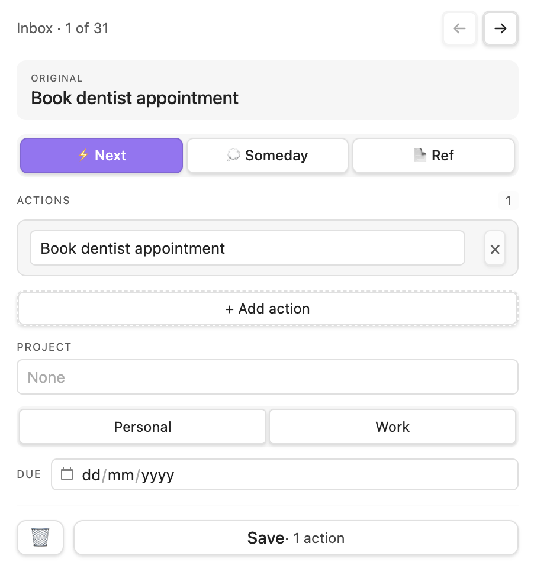

# Flow

**GTD-powered task management for Obsidian.**

Flow captures everything demanding your attention and helps you focus on what matters. Built on David Allen's Getting Things Done methodology.

[](https://github.com/tavva/flow/releases)
[](https://obsidian.md/plugins?id=flow)
[](https://github.com/tavva/flow)
[](https://obsidian.md/plugins?id=flow)
[](https://coderabbit.ai)

## The Problem

Your mind is constantly interrupted by things you need to remember: tasks, ideas, commitments, follow-ups. These open loops consume mental energy that should go towards your actual work.

Flow gets everything out of your head and into a trusted system, so you can focus completely on what you're doing right now. It's based on GTD principles but doesn't require you to follow the methodology rigidly.

## Features

- **Quick Capture** — Get thoughts out of your head instantly via command, ribbon icon, or external tools
- **Inbox Processing** — Intuitive flow to categorise inbox items into projects, actions, reference, or someday/maybe
- **Sphere Organisation** — Organise life areas (work, personal) with hierarchical projects
- **Focus View** — Curate a focused list of next actions from across your vault
- **Waiting For** — Track items you're waiting on others to complete
- **Planning Mode** — Build your focus list by selecting actions from sphere views

## Quick Start

[](https://obsidian.md/plugins?id=flow)

1. Install Flow in Obsidian (Settings → Community Plugins)
2. Click the inbox ribbon icon and capture something
3. Run "Process Inbox" to categorise items

## Installing Beta Builds

To try unreleased builds before they reach the stable community plugin listing:

1. Install [BRAT](https://github.com/TfTHacker/obsidian42-brat) from Community Plugins
2. Open BRAT settings and click "Add Beta plugin"
3. Enter `tavva/flow` and enable it

BRAT will automatically update to the latest beta when new versions are released. To switch back to stable, remove the plugin from BRAT.

If you use a beta build we'd love to hear from you in the repo [Discussions](https://github.com/tavva/flow/discussions).

## How It Works

**Capture** — When something has your attention, add it to your inbox. Don't organise yet, just get it out of your head.

**Process** — Review your inbox regularly. For each item you choose:

- What category it belongs to (project, action, reference, someday)
- Which existing project it might fit
- The sphere, and any other metadata required



_Screenshot from the current inbox processing flow._

**Plan** — Open a sphere view, enter planning mode, and click actions to add them to your focus. Your focus is your curated list of what to work on.

**Do** — Work from your focus. When done, mark complete. When blocked, convert to waiting-for.

## Focus File Location

Choose **Settings → Flow → Output Files & Folders → Focus File** to set the vault-relative path for your focus list. The default is `flow-focus-data/focus.md`; leaving the setting blank uses this default. Click **Apply** to move your focus file to the new location.

Flow creates missing folders and moves your existing focus file automatically. If the destination already exists, Flow asks whether to use that file instead; neither file is overwritten or merged. Cancelling or a failed move keeps your current location.

## Focus Items From Other Plugins

Other Obsidian plugins can put items into your focus that have no line in your vault, such as a ticket from an issue tracker. These items show in the Focus view under their source's name. Clicking one opens it at its source, and the pencil button changes its wording. Completing or removing one tells the plugin that added it.

### For plugin developers

Flow publishes an API on its plugin instance. Look it up once the workspace layout is ready, because Obsidian loads plugins in no set order:

```typescript
this.app.workspace.onLayoutReady(() => {
  const flow = this.app.plugins.getPlugin("flow")?.api;
  if (flow?.apiVersion === 1) {
    // Use the API
  }
});
```

`app.plugins` isn't in Obsidian's public typings, so declare the narrow type you use. Flow also fires `flow:api-ready` (with the API) on the workspace when it loads and `flow:api-unloaded` when it unloads, so you can notice Flow being enabled, disabled or reloaded later.

The interface is `FlowApi` in [`src/focus-api.ts`](src/focus-api.ts); copy it into your plugin.

| Method                                | What it does                                                                                                                     |
| ------------------------------------- | -------------------------------------------------------------------------------------------------------------------------------- |
| `addFocusItem(input)`                 | Adds an item with `text`, `sphere`, `sourceName`, `sourceLabel`, `url` and `externalId`, and returns its new `id`                |
| `updateFocusItem(id, changes)`        | Changes any of `text`, `sphere`, `sourceLabel` or `url`                                                                          |
| `completeFocusItem(id)`               | Marks the item complete; it stays in Focus under Completed Today                                                                 |
| `removeFocusItem(id)`                 | Takes the item out of Focus                                                                                                      |
| `getFocusItems(sourceName)`           | Returns your source's items, including completed ones                                                                            |
| `getSpheres()`                        | Returns the sphere names set in Flow's settings                                                                                  |
| `onFocusChange(sourceName, callback)` | Calls `callback` with `added`, `edited`, `completed` or `removed` changes to your source's items, and returns a function to stop |

- `sourceName` identifies your plugin's items (for example `"linear"`); `sourceLabel` is what the user sees (for example a workspace name). `externalId` is your record's own ID, and one record can have several items.
- `url` must be an `http` or `https` link. Flow won't open anything else.
- Calls with an unknown `id` reject with an error. `addFocusItem` rejects empty `text`, `sphere`, `sourceName`, `sourceLabel` or `externalId`, and `updateFocusItem` rejects an empty value for any field it changes.
- When Flow unloads, the API object you hold stops working: writes reject, and callbacks stop. Get the API again after the next `flow:api-ready`.
- Objects you receive, from `getFocusItems` or in change events, are your own copies. Changing them doesn't change Focus.

#### Change events

- Change events cover every change to the focus file: the Focus view, your own API calls, auto-clear and edits synced from another device. Pinning and reordering aren't reported. There are no events for the state when Flow starts; call `getFocusItems` and work from that.
- Flow compares the focus file with the last version it saw. Changes made close together arrive together, compared against that earlier version. For example, items you add inside a `flow:api-ready` handler, before Flow has read the file, are part of the starting state and get no `added` event. An item added and removed between two comparisons isn't reported at all.
- After a change from outside Flow (such as sync), Flow waits for the file to stay unchanged for a second before comparing.
- Treat events as hints that something changed: the file is the source of truth. This matters most for `removed`. A sync can briefly leave the focus file empty or cut short, or bring back an older copy from a device that was offline, and an out-of-date Flow on another device can remove your items. Before you act on a `removed` event outside Flow, such as removing a label in your own tool, wait a few seconds and confirm with `getFocusItems` that the item is still gone.
- Tell your users to update Flow on every device that syncs the vault before they install your plugin. Flow 1.3.12 and earlier don't know about external items and remove them when their Focus view refreshes, and that removal syncs to the other devices.
- `apiVersion` changes only when an existing method changes in a way that breaks callers. New methods don't change it.

## Focus File Format

The focus file (`flow-focus-data/focus.md` unless changed in settings) is JSONL: one JSON object per line, in the order the Focus view shows them. Other tools may read it directly. A vault item looks like:

```json
{
  "file": "Projects/Ship v1.0.md",
  "lineNumber": 12,
  "lineContent": "- [ ] Write release notes",
  "text": "Write release notes",
  "sphere": "work",
  "isGeneral": false,
  "addedAt": 1793520000000,
  "contexts": []
}
```

An item from another plugin looks like:

```json
{
  "id": "7c1e…",
  "text": "Draft section 2 of the onboarding guide",
  "sphere": "work",
  "addedAt": 1793520000000,
  "external": {
    "sourceName": "linear",
    "sourceLabel": "Acme",
    "url": "https://linear.app/acme/issue/ABC-123/onboarding-guide",
    "externalId": "ABC-123"
  },
  "contexts": []
}
```

- A line with `external` is an item from another plugin. Any other line is a vault item with `file` (vault-relative path), `lineNumber`, `lineContent`, `text`, `sphere`, `isGeneral` and `addedAt`.
- `addedAt` and `completedAt` are milliseconds since the epoch.
- `isPinned: true` means the item is in the Pinned section.
- `completedAt` is set once the item is completed. Completed items stay in the file until they're removed or auto-cleared.
- Skip lines that fail to parse, as Flow does.
- Flow may add new fields. Ignore fields you don't know.

## Project Structure

Flow projects use YAML frontmatter:

```markdown
---
priority: 2
tags: project/work
status: live
parent-project: "[[Parent Project]]"
---

# Ship v1.0

## Next actions

- [ ] Write release notes
- [ ] Update documentation
- [w] Waiting for design review from Sarah
```

## Context Tags

Add GTD context tags to your actions to filter by where or how you can do them:

```markdown
- [ ] Call dentist #context/phone
- [ ] Review budget spreadsheet #context/computer
- [ ] Pick up dry cleaning #context/errands
```

Context tags appear as filters in sphere and waiting-for views. The prefix is configurable in settings — change `context` to `at`, `ctx`, or whatever suits your workflow.

## Cover Image Generation

Flow can generate cover images for projects using AI. Configure an image-capable model via [OpenRouter](https://openrouter.ai) in Settings → Flow (`openai/gpt-5-image` creates great cover images in our experience).

## Documentation

- [GTD Guide](docs/gtd-guide.md) — Understanding GTD methodology and Flow's implementation
- [Project Templates](docs/project-templates.md) — Customising project templates, including Templater support
- [Quick Capture Methods](docs/quick-capture.md) — Tools and workflows for capturing from any device
- [Contributing](CONTRIBUTING.md) — Development setup, architecture, and how to contribute

## Privacy

- AI features are optional and disabled by default — Flow works fully without them
- API keys stored locally in Obsidian settings
- Flow contacts OpenRouter only when AI cover image generation is enabled and you trigger image generation
- Project title, description, and context used for cover generation are sent to your configured OpenRouter-compatible endpoint for that request
- No telemetry or analytics
- Your vault stays under your control

## Support

- [Report bugs](https://github.com/tavva/flow/issues)
- [Discussions](https://github.com/tavva/flow/discussions)

## License

GPL-3.0-or-later — see [LICENSE](LICENSE) for details.
